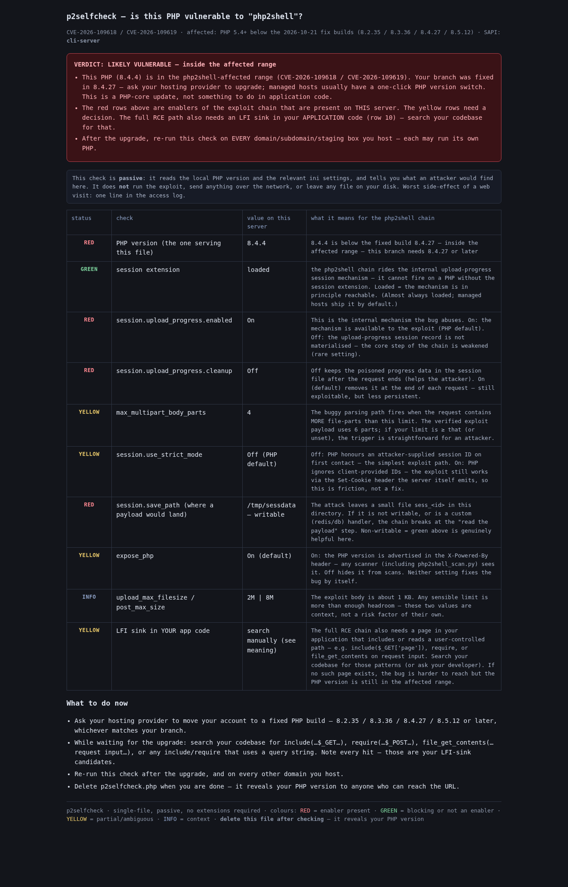

# p2selfcheck

**Is *your* PHP vulnerable to *php2shell* (CVE-2026-109618 / CVE-2026-109619)?**

A single-file, passive self-check for managed web hosting.

`p2selfcheck` is one self-contained PHP file. You upload it, open it in a
browser, read the verdict, act, delete it. No installation, no dependencies,
no shell access required. No PHP extensions needed — it runs on stock PHP
5.4+, including on the old PHP versions that *are* part of the
vulnerability range.

```
┌────────────────────────────────────────────────────────────────────┐
│  [RED   ] VERDICT: LIKELY VULNERABLE — inside the affected range   │
│                                                            PHP 8.4.4 │
├────────────────────────────────────────────────────────────────────┤
│  [RED]    PHP version (serving this file)      8.4.4               │
│  [GREEN]  session extension                    loaded              │
│  [RED]    session.upload_progress.enabled      On                 │
│  [YELLOW] session.upload_progress.cleanup      On  (default)      │
│  [YELLOW] max_multipart_body_parts             4                  │
│  [YELLOW] session.use_strict_mode              Off  (default)     │
│  [RED]    session.save_path                    /tmp/sessdata — wrt│
│  [YELLOW] expose_php                           On  (default)      │
│  [INFO]   upload_max_filesize / post_max_size  2M  |  8M          │
│  [YELLOW] LFI sink in YOUR code                search manually     │
└────────────────────────────────────────────────────────────────────┘
```
*(output trimmed for the banner — the real page shows the full verdict text
and per-check explanations)*

<p align="center">
  
</p>

---

## What is "php2shell"?

On **2026-10-21** PHP shipped emergency releases (8.2.35 / 8.3.36 / 8.4.27 /
8.5.12) fixing two critical bugs, tracked as **CVE-2026-109618** and
**CVE-2026-109619**. Both live in the core multipart / session-upload-progress
area that has existed since PHP 5.4, and both are exploitable as
**unauthenticated remote code execution (CVSS 9.2)**:

1. an attacker sends a crafted multipart `POST` whose file-part count exceeds
   `max_multipart_body_parts`, hitting a buggy path in the multipart parser;
2. PHP's upload-progress mechanism lets the attacker control the *session ID*
   and the *session file contents* — the attacker chooses exactly where a
   small payload file lands (`session.save_path/sess_<id>`);
3. the app itself (a page that `include`s / `require`s / `file_get_contents`
   a request-influenced path — an LFI sink) is then asked to read that file;
4. because the payload is a session file with PHP open tags, the code
   executes in the app's context: **RCE, no auth, no CSRF needed.**

Every PHP ≥ 5.4 below the 2026-10-21 fixed builds is in the affected range;
PHP ≤ 8.1 is end-of-life and *will never be patched* — it is vulnerable no
matter what.

## What this tool does — and, importantly, what it does NOT

`p2selfcheck` is a **passive self-check for the PHP that is actually serving
your page.** It answers three questions:

1. **Is this PHP in the affected range?** It compares `phpversion()` against
   the fixed-build table for every branch (8.2→8.2.35, 8.3→8.3.36,
   8.4→8.4.27, 8.5→8.5.12), so it also flags EOL branches 7.4/8.0/8.1 that
   will *never* get a patch.
2. **Are the prerequisites for the exploit chain present?** It reports the
   ini settings the bug rides on (`session.upload_progress.enabled`,
   `session.upload_progress.cleanup`, `max_multipart_body_parts`,
   `session.use_strict_mode`, writable `session.save_path`, `expose_php`,
   upload size limits) and the one extension the core mechanism depends on
   (`session`). These are *reads* — nothing is activated or tested.
3. **What does an attacker still need to find in your code?** The final row
   tells you exactly what to grep for (an LFI sink), because that is the only
   part of the chain no outside check can see for you.

It deliberately does **not**:

- run the exploit or *simulate* it (no multipart poison POST, no session
  hijack under a chosen ID, no PHP open tags executed),
- read your application code, include anything, or hit the filesystem
  outside of `session_save_path()` (a *single* read/write to probe
  writability of the session directory is the only filesystem touch, and it
  cleans up after itself),
- make network calls,
- require PHP extensions beyond the core (the `session` extension is checked
  for *presence*, not loaded), or
- leave anything behind.

The only filesystem contact is **one** writability probe inside your
`session.save_path` directory (a hidden file, created and removed within the
same request). Worst observable side-effect of a single page load: one line
in your access log, and that one probe file — which the request deletes.

## Quick start

### In a browser (managed web hosting — the main use case)

1. Upload `p2selfcheck.php` to your public web root — the folder your domain
   serves from: `public_html/`, `htdocs/`, `www/`, …
   If you host several domains/subdomains, or have a staging box, **upload
   and open one copy per domain** — each one may run its own PHP version.
2. Point a browser at it:
   ```
   https://your-domain.com/p2selfcheck.php
   ```
3. Read the verdict banner and the colour-coded check table.
4. Act: the "Next steps" section tells you exactly what to ask your
   provider (upgrade to the fixed build for your branch), what to grep for
   in code, and to re-run on every other domain.
5. **Delete the file.** It reveals your PHP version to anyone who can reach
   the URL.

### From a shell (if you have one)

```
php p2selfcheck.php
```
Same checks, plain-text output — handy for scripting the verdict:

```
php p2selfcheck.php | grep -E 'VERDICT' 
# → VERDICT: LIKELY VULNERABLE — inside the affected range
# → (green or yellow) VERDICT: PATCHED (this PHP)
```

> **Heads-up for hosts that rewrite the request for "friendly URLs":** the
> checks read `PHP_VERSION`, so the result is accurate whatever the URL is;
> just make sure the request is actually processed by the PHP you care
> about (e.g. point at a page that you *know* is served by PHP, and check
> the `X-Powered-By` header too).

## How to read the colour codes

| colour | meaning in this context |
|---|---|
| 🔴 **RED** | An *enabler* of the exploit chain is present on this PHP — this setting is helping an attacker. |
| 🟢 **GREEN** | This setting *blocks* or does not aid the chain — leave it, or treat it as a mitigation. |
| 🟡 **YELLOW** | Partial, default-leaning, or needs a human decision — read the explanation. |
| 🔵 **INFO**  | Context (e.g. your upload size limits); not itself a risk factor. |

Rows that matter most in practice:

- **PHP version** — the only thing that *fixes* the bug. Red here means "ask
  your provider to move you to a fixed build".
- **session extension / `session.upload_progress.enabled`** — the mechanism
  the bug abuses. Green here (disabled) would be a *genuine mitigation*,
  though it is rare.
- **`session.save_path` writable** — the payload landing zone. If it's not
  a plain writable directory (custom redis/db handler, read-only dir), the
  chain breaks at the "read the payload" step.
- **`expose_php`** — not a fix, but *hides* the version from header checks.
- **LFI sink in your app code** — the only step only *you* can verify:
  search for `include($_GET[...])`, `require`, `file_get_contents` with
  request-derived arguments, template loaders, and page routers.

## Repository layout

```
p2selfcheck/
├─ p2selfcheck.php      ← the whole tool (single file, no deps)
├─ README.md
├─ LICENSE
├─ .gitignore
├─ docs/
│  └─ screenshot.png    ← the page as rendered in a browser
└─ examples/
   └─ cli-output-vulnerable.txt   ← authentic CLI output from a vulnerable (8.4.4) host
```

There is intentionally nothing else — the goal is "one file I can upload and
delete."

## Privacy & security notes

- The check is **local**: it only reflects the PHP that serves the request.
  If your site sits behind a proxy that adds `X-Powered-By`, check *both* the
  banner version and the value `p2selfcheck` reports (which is the
  authoritative one, since it reads the real `phpversion()`).
- Do not leave the file up long-term. The HTML contains your PHP version and
  several ini values — useful intelligence for anyone scanning.
- The file does not make network calls and reads no files (except a
  single, cleaned-up write to the session directory to test writability).
- Want a zero-web-footprint run? Execute in CLI mode:
  `php p2selfcheck.php`. Same checks, plain text, and you can pipe the
  verdict into a script.

## FAQ

**Can this run the exploit?**
No. It is a passive check — it reads the PHP version and the relevant ini
settings and reports them. It does not send a crafted multipart, does not
create an upload-progress session, and does not include a session file. If
you later want to actively test exploitation against a *remote* host you own,
that is a separate, explicitly-activated testing tool — this file does not
include one.

**Does it change anything on my server?**
Effectively no. It reads `phpversion()`, the extension list, several ini
settings, and `session_save_path()`. The only write is a single hidden probe
file inside your `session.save_path` directory (to tell you whether that
directory is writable — a payload-landing check), which it unlinks at the end
of the same request. It does not modify any ini value, does not write
application files, and does not touch the database.

**Will the browser flag anything?**
It's served straight from PHP — no JS, no cookies set by this file. It may
add one `PHPSESSID` cookie if the host's session extension is active and
`session.use_strict_mode=Off` (which is itself a useful signal this check
reports).

**What about my subdomains / staging?**
Each one may run a different PHP. Upload-and-check each one. This is the
most common mistake: you patch the main domain and forget `api.`, `stage.`,
`mail.`, etc.

**Does this need to be kept?**
No. It is a diagnostic. Upload, check, act, delete.

## License

MIT — see [LICENSE](LICENSE).
